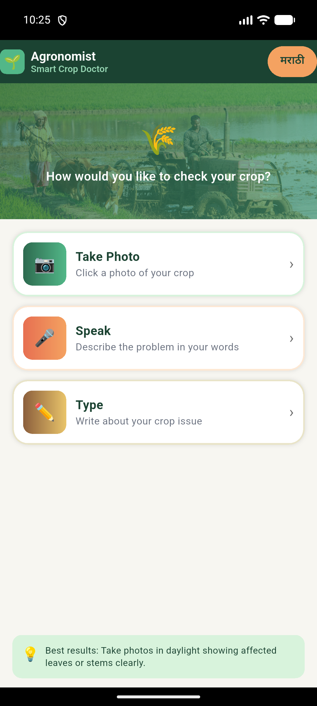
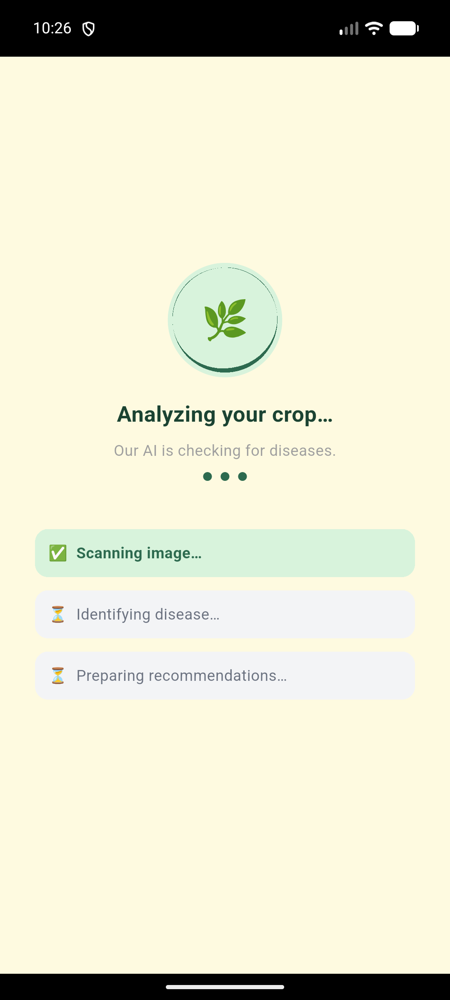
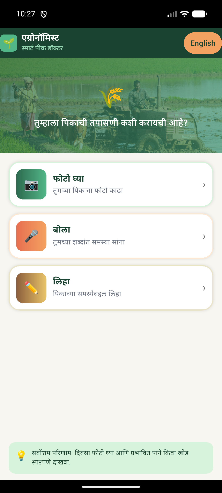
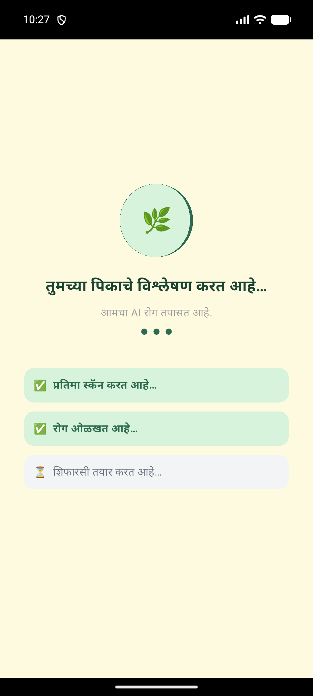

# 🌱 Agronomist: Edge-Based Crop Pathology & Advisory System

[](https://flutter.dev)
[](https://www.tensorflow.org/lite)
[](https://developer.android.com)
[](https://firebase.google.com)

An intelligent, on-device agricultural diagnostic and advisory platform built with **Flutter**, **TensorFlow Lite**, and **Firebase Firestore**. Engineered for zero-latency, offline-capable field diagnostics, Agronomist provides smallholder farmers with real-time foliar disease detection, selective decision-gating to suppress false positives, and actionable, non-synthetic bio-fertilizer prescriptions.

---

## 📸 System Walkthrough & Operational Pipeline

| (a) Multi-Modal Entry | (b) Specimen Acquisition | (c) Real-Time Inference | (d) Clinical Prescription |
|:---:|:---:|:---:|:---:|
|  |  |  |  |
| *Visual, voice & text modes with 1-tap Marathi localization.* | *In-app viewfinder capturing leaf pathology with voice/text fallback.* | *Local quantized TFLite inference verifying decision gate $\tau \ge 0.65$.* | *Confidence score (79%) & per-acre organic bio-fertilizer dosage.* |

## 🚀 Key Features

* **Multi-Modal Diagnostic Input:**
  * **Visual Pathology:** Real-time camera acquisition and gallery selection with automatic EXIF orientation normalization.
  * **Speech & Voice-to-Text:** Integrated regional voice recognition supporting agricultural Marathi and English dialects.
  * **Manual Querying:** Built-in keyword fallback and symptom lookup.
* **Edge-Native Inference & Decision Gate:**
  * **Quantized MobileNetV2 (224×224×3):** Runs locally via native C++ TFLite delegates with zero cloud latency and no field connectivity required.
  * **Selective Decision Boundary ($\tau = 0.65$):** Enforces an automated abstention gate—inferences yielding confidence below 65% are flagged to request photo re-acquisition, protecting farmers against false-positive chemical or biological interventions.
* **Targeted Organic Advisory Engine:**
  * Mapped pathogen countermeasures prescribing specific organic inputs (**BIO-F Super**, **BIO-F Fishmeal**, and **BIO-F Phosphate**).
  * Clear, localized dosage metrics (e.g., *50–100 kg/acre at root zone*).
  * Real-time pricing synchronization via Firebase Firestore with offline cache fallback.
* **Bilingual Localization:**
  * Full ARB-based localization supporting English and Marathi across all UI elements, pathogen names, symptom descriptions, and advisory guidelines.
* **Report Export:**
  * Direct generation and sharing of diagnostic cards via WhatsApp, SMS, or system share sheet (`share_plus`).

---

## 🌾 Supported Crops & Pathologies (33 Classes)

| Category | Crops | Pathologies & Physiological Disorders |
| :--- | :--- | :--- |
| **Cash Crops** | Sugarcane (*ऊस*), Cotton (*कापूस*) | Red Rot, Smut, Wilt, Bacterial Blight, Root Rot, Leaf Curl Virus |
| **Cereals & Millets** | Rice (*भात*), Maize (*मका*), Jowar (*ज्वारी*), Bajra (*बाजरी*) | Blast, Brown Spot, Sheath Blight, Turcicum Leaf Blight, Common Rust, Maydis Leaf Blight, Grain Mold, Downy Mildew, Anthracnose, Ergot |
| **Pulses** | Tur Dal (*तूर*), Moong (*मूग*), Urad Dal (*उडीद*) | Fusarium Wilt, Sterility Mosaic, Phytophthora Blight, Yellow Mosaic Virus, Powdery Mildew, Cercospora Leaf Spot, Leaf Crinkle |
| **Oilseeds** | Soybean (*सोयाबीन*), Groundnut (*भुईमूग*) | Rust, Bacterial Blight, Frogeye Leaf Spot, Tikka Leaf Spot, Collar/Crown Rot |

---

## 🛠 Tech Stack & Architecture

* **Frontend:** Flutter SDK (Dart)
* **Edge ML Runtime:** `tflite_flutter` (C++ dynamic library bindings)
* **Model Topology:** MobileNetV2 with $[-1, 1]$ zero-centered floating-point/int8 tensor normalization
* **Cloud & Storage:** Firebase Core, Cloud Firestore, Firebase Storage
* **Graphics Pipeline:** Configured with `RenderMode.texture` (`FlutterTextureView`) in `MainActivity.kt` to eliminate GPU surface deadlocks across customized OEM Android distributions.

---

## 📦 Getting Started

### Prerequisites
* [Flutter SDK](https://docs.flutter.dev/get-started/install) (3.x+)
* [Android SDK](https://developer.android.com/studio) (API 34+)
* Physical Android device (ARM64 recommended) or Android Emulator

### Installation & Run

1. **Clone the repository:**
   ```bash
   git clone [https://github.com/ketangrawal/agronomist.git](https://github.com/ketangrawal/agronomist.git)
   cd agronomist